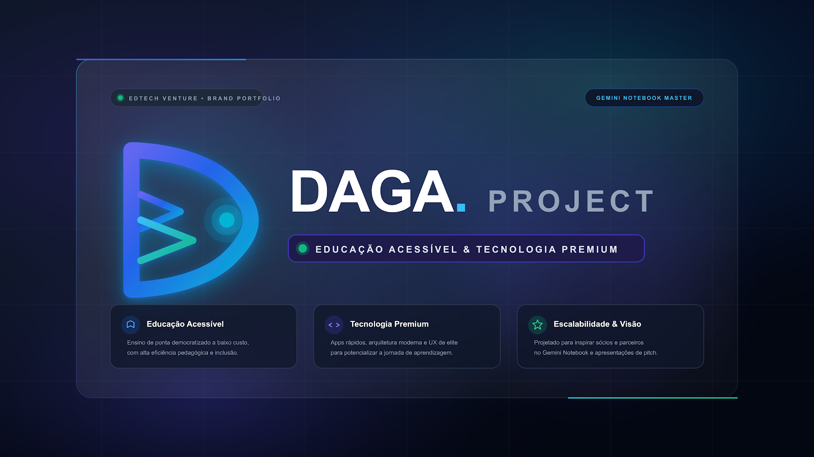

<!-- Substitua o src abaixo pelo caminho relativo do seu banner no repositório .github (ex: ./assets/banner.png) -->

 

  
  
  

<h3>Educação de alto impacto, sem barreiras institucionais.</h3>

  Construímos aplicações modernas, ecossistemas digitais e recursos educacionais de excelência com foco em acessibilidade, rigor intelectual e baixo custo.

---

## 🎯 Nossa Missão

Acreditamos que o acesso a ferramentas tecnológicas de ponta e materiais de estudo estruturados não deve ser um privilégio restrito. O **DAGA. PROJECT** nasceu para unir engenharia de software de alta qualidade a experiências de aprendizagem claras, intuitivas e acolhedoras — projetadas para estudantes e profissionais em evolução contínua.

---

## 🚀 O Que Construímos

* **Aplicações & Plataformas Educacionais:** Produtos digitais focados em clareza cognitiva, trilhas de estudo estruturadas e alta performance.
* **Recursos & Materiais de Excelência:** Conteúdos técnicos, guias práticos e ferramentas de apoio desenhados com profundidade pedagógica.
* **Experiência & Design (*Academic Luminary*):** Interfaces minimalistas que equilibram rigor acadêmico e conforto visual, reduzindo a fadiga em leituras e estudos prolongados.

---

## 🧭 Nossos Pilares

| Pilar | Compromisso |
| :--- | :--- |
| **Acessibilidade Real** | Democratizar o acesso a recursos educacionais e tecnológicos com custo justo e alcance amplo. |
| **Excelência Técnica** | Arquitetura moderna, código limpo e foco absoluto na experiência e fluidez do usuário. |
| **Clareza & Foco** | Ambientes livres de ruído visual, pensados para concentração profunda e aprendizado contínuo. |

---

**Construindo o futuro da educação acessível com tecnologia.**  
🌐 [github.com/dagaproject](https://github.com/dagaproject)

